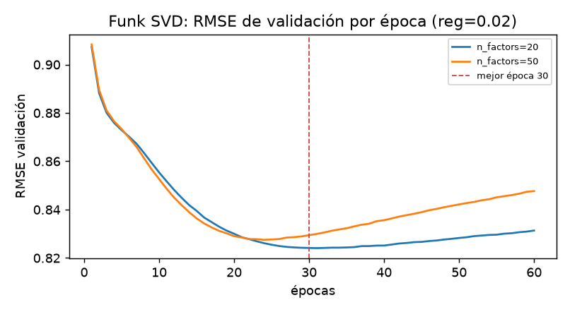

# Selección de modelo (solo validación)

Protocolo: misma partición temporal por usuario, mismas filas y semilla 42. Ningún modelo, hiperparámetro ni feature se eligió con test. Ranking con 99 negativos muestreados por usuario y hasta 2 000 usuarios. La tabla muestra la mejor configuración de cada familia en validación; los grids completos están en `reports/results/val_results.csv`.

| Modelo | Mejor configuración (val) | RMSE val | MAE val | NDCG@10 | Recall@10 | Tiempo de ajuste | Interpretabilidad | Cold start |
|---|---|---:|---:|---:|---:|---:|---|---|
| Media global | — | 1.0532 | 0.8275 | 0.1026 | 0.1176 | 0.0 s | Trivial (una constante) | Constante; no distingue usuarios/películas |
| Media de película (damping) | damping=5 | 0.9570 | 0.7371 | 0.2987 | 0.3395 | 0.1 s | Alta (media por película) | Cae a la media global si la película es nueva |
| Sesgos usuario+película | damping=5 | 0.8668 | 0.6577 | 0.2525 | 0.2953 | 2.0 s | Alta (sesgo por usuario y película) | Cae a mu + b_u (o mu si el usuario también es nuevo) |
| Popularidad (solo ranking) | — | — | — | 0.5975 | 0.6654 | 0.0 s | Alta (conteo de ratings) | Un ítem nuevo recibe score 0 |
| Item-KNN | k=50, shrink=50 | 0.8198 | 0.6152 | 0.4151 | 0.4413 | 11.0 s | Media (vecinos de ítems; se puede listar la explicación) | Cae al baseline de sesgos; sin vecinos no suma corrección |
| Funk SVD | n_factors=20, lr=0.005, reg=0.02, epochs=24 | 0.8261 | 0.6248 | 0.3117 | 0.3464 | 19.0 s | Baja-media (factores latentes no nombrados) | Usuario/película nuevo -> sesgo 0 y factores nulos; cae a mu |
| Ridge + features | alpha=1 | 0.8578 | 0.6514 | 0.3409 | 0.3826 | 1.7 s | Media (coeficientes sobre features interpretables) | Features con fillna(0)/media de train; el modelo no extrapola historia |
| HistGB + features | max_depth=6, learning_rate=0.1, max_iter=300 | 0.8472 | 0.6421 | 0.2962 | 0.3264 | 55.2 s | Baja-media (importancias, no dirección) | Igual que Ridge: features con valores por defecto de train |

**Notas de lectura**

- La popularidad no predice rating; se incluye como baseline de ranking. Su NDCG@10 (0.5975) y Recall@10 (0.6654) son altos porque el conjunto de candidatos mezcla relevantes del usuario con 99 negativos y las películas populares tienden a tener ratings ≥ 4. No es un modelo de rating comparable.

- El mejor modelo manual por RMSE es **Item-KNN (k=50, shrink=50)**: 0.8198, un **5.4%** mejor que el baseline de sesgos (0.8668) y un **0.76%** mejor que el mejor Funk SVD (0.8261). La diferencia es pequeña; se elige por RMSE, que es la métrica principal definida en `reports/01_problema.md`.

- En ranking personalizado, Item-KNN también es el mejor de los modelos de rating (NDCG@10 0.4151, Recall@10 0.4413). La popularidad sigue siendo un baseline de ranking fuerte y honesto.

- Coste: Item-KNN tarda 11.0 s en ajustar; Funk SVD 19.0 s (20 factores, 24 épocas); HistGB 55.2 s. Ridge es el más barato de los tabulares (1.7 s) pero su RMSE es 4.6% peor que Item-KNN.

- Interpretabilidad: el baseline de sesgos y la media por película son los más explicables; Item-KNN permite decir “te gustó X porque se parece a Y”; Funk SVD no nombra factores; HistGB da importancias pero no dirección.

- Cold start: no hay usuarios fríos en val/test (`pct_ratings_cold_user = 0.0`); solo un 0.0029% de ratings de val y 0.0368% de test son de películas no vistas en train. Todos los modelos caen a un sesgo/constante de train; el baseline de sesgos es el fallback más explícito. No se optimizó para cold start porque el split no lo permite medir con potencia.

## Funk SVD: revisión de épocas

El grid de selección mantiene 24 épocas (la fijada en `config/config.yaml`). Como control adicional se entrenó una curva larga con la mejor regularización (`reg=0.02`) y dos tamaños de factor. En este subconjunto el mínimo de validación aparece en la época 24 con 50 factores (**0.8275**) y en la época 30 con 20 factores (**0.8241**); a 24 épocas el mejor es **0.8275**. Esto no cambia el modelo elegido (el SVD sigue por detrás de Item-KNN); el modelo reportado es el de 24 épocas por consistencia con la configuración auditada.

La curva completa está en `reports/results/svd_history.csv` y la figura en `reports/figures/svd_history.png`.

## Justificación de la elección

Se elige **Item-KNN (k=50, shrink=50)** como mejor modelo manual porque: (i) tiene el menor RMSE de validación entre los modelos que predicen rating; (ii) su coste (11 s) es menor que Funk SVD y que HistGB; (iii) su explicación por vecinos es más accionable que los factores latentes; y (iv) su fallback al baseline de sesgos cubre el cold start observado. Funk SVD queda muy cerca y sería preferible si el despliegue exigiera un modelo compacto de baja latencia; Ridge/HistGB no justifican su coste con estas features. La decisión no se basa solo en la métrica: se documentan coste, interpretabilidad y cold start, y se mantiene el baseline de sesgos como referencia y fallback. El test se evaluará una sola vez en `final_eval.py` con esta elección ya congelada.
